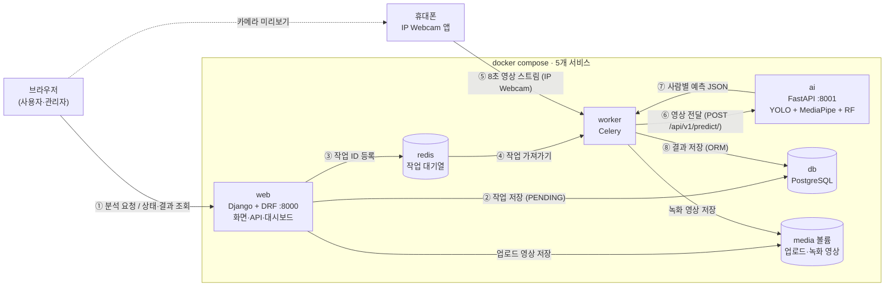
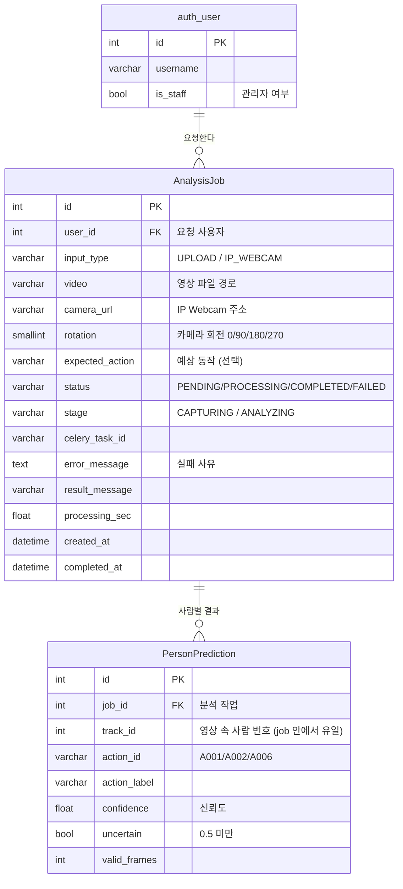
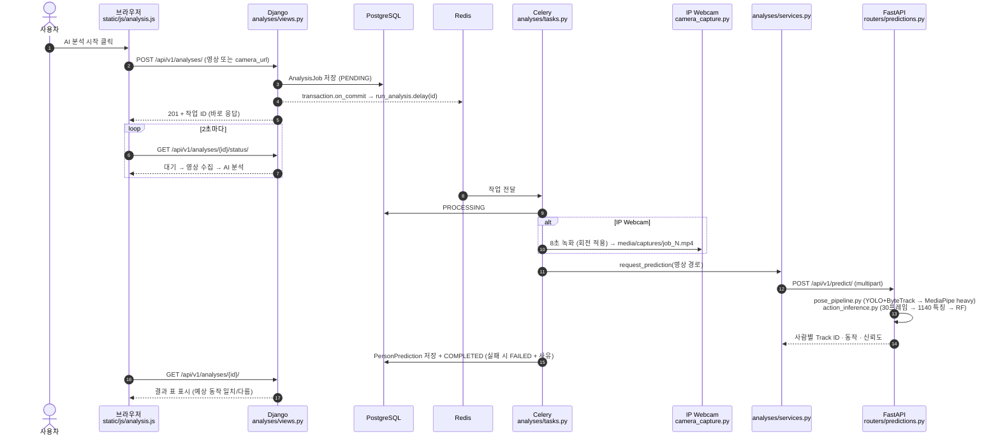
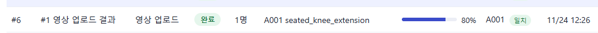
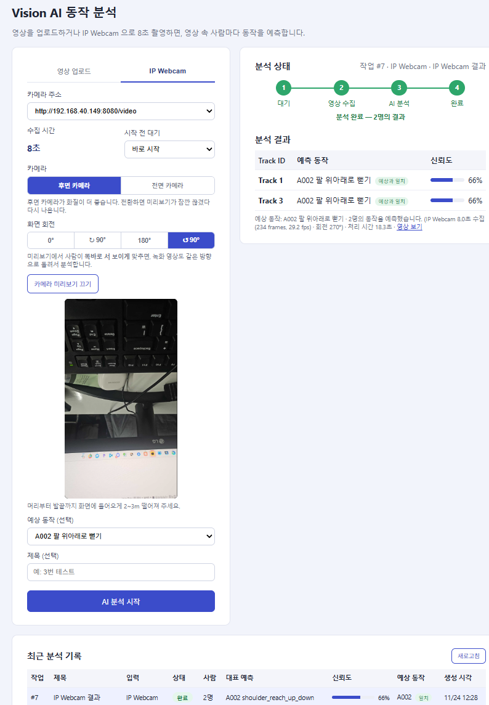
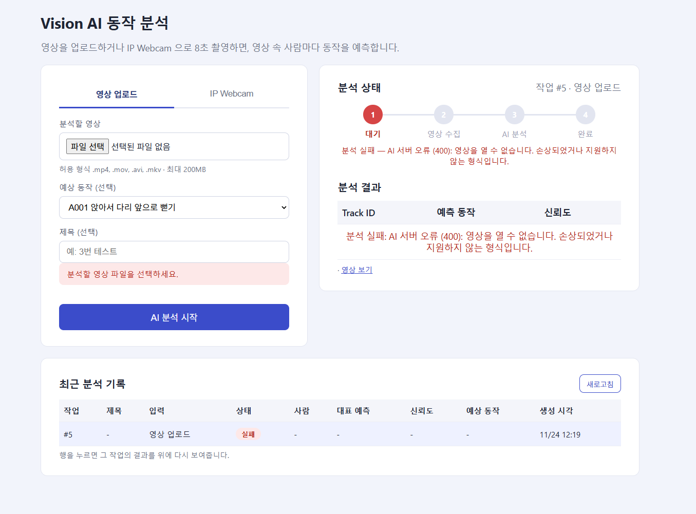
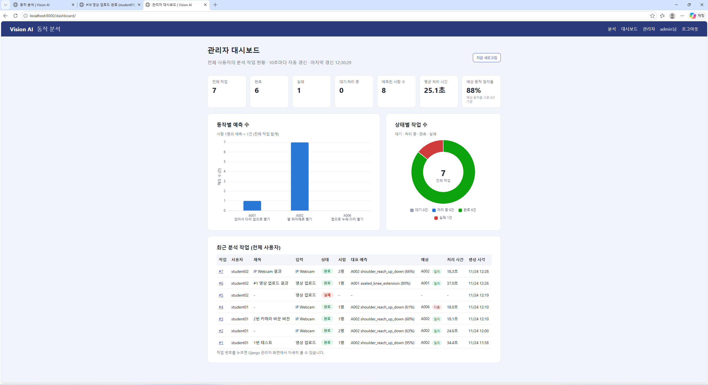
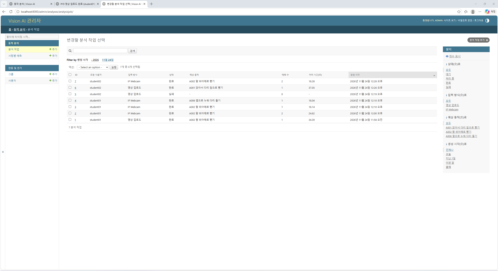

# Vision AI 동작추론 플랫폼

## 1. 프로젝트 소개

영상 속 **사람마다 어떤 운동 동작을 하는지** 자동으로 판별하는 웹 서비스입니다.
사용자는 **영상 파일을 업로드**하거나 휴대폰 **IP Webcam 으로 8초 촬영**해 분석을 요청하고,
화면에서 사람별 **Track ID · 예측 동작 · 신뢰도**와 예상 동작 일치 여부를 확인합니다.
관리자는 전체 작업 목록과 **동작별·상태별 차트 대시보드**로 서비스 현황을 봅니다.

- 지원 입력: 영상 업로드(mp4/mov/avi/mkv, 최대 200MB), IP Webcam 8초 수집
- 지원 동작: A001 앉아서 다리 앞으로 뻗기 · A002 팔 위아래로 뻗기 · A006 옆으로 누워 다리 들기
- 교과10 9~10일차 자율 프로젝트 · 팀 heavy(MediaPipe) 모델 기반

## 2. 실행 방법

```bash
# 1) 저장소 받기
git clone <저장소 주소> && cd vision_action_platform

# 2) 설정 파일 (실제 비밀번호·카메라 주소는 .env 에만, Git 에 올리지 않음)
cp .env.example .env
#   POSTGRES_PASSWORD, DJANGO_SECRET_KEY 변경
#   ALLOWED_CAMERA_URLS=http://<휴대폰IP>:8080/video

# 3) 모델 파일 5개를 ai_service/models/ 에 복사 (Git 제외)
#   rf_action_team.joblib, rf_feature_columns.json, rf_training_info.json,
#   pose_landmarker_heavy.task, yolo11n-pose.pt

# 4) 5개 서비스 빌드·실행 (web 이 시작할 때 migrate 자동 적용)
docker compose up -d --build
docker compose ps                      # db/redis/ai healthy, web/worker Up

# 5) 관리자 계정 생성
docker compose exec web python manage.py createsuperuser
```

| 화면 | 주소 | 대상 |
|---|---|---|
| 분석 화면 | http://localhost:8000/ | 회원가입 후 로그인한 사용자 |
| 관리자 대시보드 | http://localhost:8000/dashboard/ | staff 계정만 |
| Django 관리자 | http://localhost:8000/admin/ | staff 계정만 |
| FastAPI 문서 | http://localhost:8001/docs | 개발 확인용 |

```bash
docker compose logs -f worker ai       # 처리 로그
docker compose down                    # 중지 (DB·영상 볼륨 유지)
```

IP Webcam: 휴대폰 앱에서 **Start server** → PC 와 같은 와이파이 → 화면의 **미리보기**로 전신이 보이는지 확인 →
휴대폰을 세로로 세웠다면 **화면 회전** 버튼으로 사람이 똑바로 서 보이게 맞춘 뒤 분석합니다.

## 3. 전체 아키텍처

`docker-compose.yml` 이 실행하는 서비스 5개: **web(Django·DRF), worker(Celery), ai(FastAPI), redis, db(PostgreSQL)**



| 역할 분리 | 이유 |
|---|---|
| **FastAPI 는 추론만** (DB 접근 없음) | 무거운 AI 모델을 한 곳에서만 로드하고, 웹 서비스와 독립적으로 재시작·교체 |
| **Django 가 DB·권한·화면 담당** | 로그인·사용자별 권한·ORM 저장·대시보드 집계를 한 곳에서 처리 |
| **Celery + Redis 비동기** | 분석이 수십 초 걸려도 웹 요청은 바로 작업 ID 를 돌려줌 |

## 4. DB 설계 (ERD)

직접 작성한 모델: `backend/analyses/models.py`



| 테이블 | 저장하는 것 |
|---|---|
| `auth_user` | Django 기본 사용자 (회원가입·로그인, staff 여부) |
| `AnalysisJob` | 분석 요청 1건: 누가, 어떤 입력으로, 지금 어떤 상태인지, 실패 사유·처리 시간 |
| `PersonPrediction` | 영상 속 사람 1명의 예측 (두 사람이 보이면 작업 1건 → 결과 2건) |

## 5. AI 분석 버튼 구현 흐름



| 단계 | 대표 파일 |
|---|---|
| 화면·버튼·상태 표시 | `backend/templates/analyses/index.html`, `backend/static/js/analysis.js` |
| 작업 생성·조회 API, 권한 | `backend/analyses/views.py`, `serializers.py`, `urls.py` |
| 비동기 처리 | `backend/config/celery.py`, `backend/analyses/tasks.py` |
| 카메라 수집·전환 | `backend/analyses/camera_capture.py`, `camera_views.py` |
| FastAPI 호출 | `backend/analyses/services.py` |
| AI 추론 | `ai_service/routers/predictions.py`, `services/pose_pipeline.py`, `services/action_inference.py` |
| 관리자 대시보드 | `backend/analyses/dashboard_views.py`, `static/js/dashboard.js` (Chart.js) |

## 6. 사용한 모델과 입력 형식

| 항목 | 내용 |
|---|---|
| 동작 분류 모델 | `rf_action_team.joblib` (RandomForest, 팀원 3명 × 3개 동작 영상 48개로 학습) |
| 부속 파일 | `rf_feature_columns.json` (1,140개 특징 순서), `rf_training_info.json` (클래스 ↔ 동작 ID) |
| 사람 검출·추적 | `yolo11n-pose.pt` + ByteTrack (`configs/bytetrack_live.yaml`) |
| 관절 추출 | `pose_landmarker_heavy.task` (MediaPipe heavy, 사람별 crop → 33점 → COCO 17점) |
| 특징 | 사람별 관절 시퀀스 → 30프레임으로 재샘플링 → 1,140개 특징 |
| 지원 동작 | A001 seated_knee_extension · A002 shoulder_reach_up_down · A006 side_lying_leg_raise |
| 업로드 영상 | mp4 / mov / avi / mkv, 최대 200MB, 10프레임 이상 |
| IP Webcam | `http://<휴대폰IP>:8080/video` 를 8초 수집 (허용 목록의 주소만), 회전 0/90/180/270° |

**FastAPI `POST /api/v1/predict/`** — 입력: 영상 파일 1개(multipart) → 출력(JSON):

```json
{
  "people_detected": 2,
  "predictions": [
    {"track_id": 1, "action_id": "A002", "action_label": "shoulder_reach_up_down",
     "confidence": 0.58, "uncertain": false, "valid_frames": 230}
  ],
  "skipped_tracks": [],
  "processing_sec": 21.4,
  "message": "2명의 동작을 예측했습니다."
}
```

Joblib 모델은 영상을 직접 받지 못하므로, FastAPI 가 **영상 → 사람 검출 → 관절 → 학습 때와 같은 1,140 특징**으로 바꾼 뒤 모델에 넣습니다.

## 7. 실행 결과와 검증

### 정상 분석 — 영상 업로드

학습 동작 영상(A002) 업로드 → Track 1 **A002 팔 위아래로 뻗기 95%**, 예상 동작과 일치.

### 정상 분석 — IP Webcam

휴대폰 IP Webcam 으로 8초 수집 → 영상 수집 · AI 분석 단계를 거쳐 사람별 예측 동작과 신뢰도 표시.

### 오류·실패

확장자만 mp4 인 손상 파일 업로드 → 작업 **실패** 저장, "영상을 열 수 없습니다. 손상되었거나 지원하지 않는 형식입니다." 표시.

### 관리자 대시보드

staff 전용 `/dashboard/` — 동작별 예측 수(막대), 상태별 작업 수(도넛), 최근 작업, 10초 자동 갱신.


Django Admin — 작업 목록·상태/입력 방식 필터·사람별 예측(inline).

### 기능 테스트 (T01 ~ T10)

| 테스트 | 입력 또는 상황 | 결과 |
|---|---|---|
| T01 모델 불러오기 | ai 컨테이너 시작 | ✅ 클래스 3개, 특징 1,140개 확인 |
| T02 영상 업로드 | 학습 동작 MP4 | ✅ 완료, A002 95% |
| T03 IP Webcam | 휴대폰 8초 수집 | ✅ 완료 (242 frames, 30 fps) |
| T04 사람별 결과 | 두 사람이 보이는 영상 | ✅ Track 1·2 분리 저장 |
| T05 비동기 처리 | 분석 요청 직후 | ✅ 즉시 201 + 작업 ID, 화면은 상태만 조회 |
| T06 영구 저장 | 완료 후 새로고침 | ✅ 결과 유지 |
| T07 CRUD 권한 | student02 가 student01 작업 접근 | ✅ 조회·수정·삭제 모두 404, 목록 0건 |
| T08 관리자 | admin 계정 | ✅ 전체 작업 + 차트 2개, 일반 사용자는 403 |
| T09 예외 처리 | 손상 파일 / 카메라 꺼짐 | ✅ 실패 상태 + 한글 사유 저장 |
| T10 Docker | `restart`, `down` → `up` | ✅ 사용자·작업·예측·영상 유지 (볼륨) |

### 추가 구현
- 진행 단계 표시(대기 → 영상 수집 → AI 분석 → 완료), 수집 중 카운트다운, 시작 전 대기(0/3/5/10초)
- IP Webcam **카메라 미리보기**, **화면 회전**(미리보기와 녹화 영상 함께), **전면/후면 카메라 전환**
- 예상 동작 선택 → 결과·기록에 **일치 / 일부 일치 / 다름** 배지, 낮은 신뢰도는 **불확실** 표시

### 한계와 원인 분석
- 학습 데이터가 팀원 3명 · 동작 3개뿐이라 새 사람·새 촬영 환경에서는 틀릴 수 있습니다.
- 휴대폰을 **세로로 세워 촬영**하면 영상이 90° 누워 들어와 서 있는 동작도 **A006(옆으로 누워 다리 들기)** 으로 예측됨
  → 원인을 *입력 품질* 단계에서 찾아 **화면 회전 기능**을 추가했고, 회전 후 A002 로 올바르게 예측됨.
- 전신이 보이지 않으면(상체만 촬영) 사람이 검출되지 않거나 다리 관절이 없어 예측이 불안정합니다.

## Git 에 올리지 않는 것
`.env`(비밀번호·카메라 주소), `ai_service/models/*`(모델), 영상(`*.mp4`, `media/`), `.venv` —
팀원 얼굴이 나오는 영상과 데이터는 커밋하지 않습니다.
